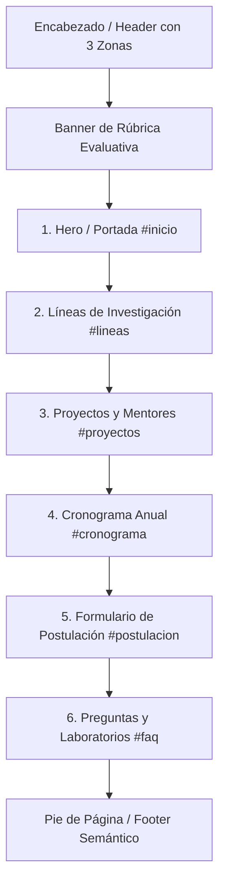

# INFORME TÉCNICO Y MEMORIA DE PROYECTO
## Iniciativa Académica UPS WEB: Semillero de Innovación, Desarrollo Web y Software Libre

---

### Datos del Proyecto
- **Institución:** Universidad Politécnica Salesiana (UPS) / Facultad de Ingeniería y Ciencias de la Computación
- **Programa:** Iniciativa Académica UPS WEB (Convocatoria Anual 2026)
- **Tecnologías:** HTML5 Semántico, CSS3 Puro (Vanilla CSS), JavaScript Estándar (ES6+ Vanilla JS)
- **Normativa de Accesibilidad:** W3C WCAG 2.2 Nivel AA / AAA
- **Enfoque de Diseño:** Mobile-First, Responsive Web Design (RWD) y Resiliencia sin Dependencias

---

## 1. Resumen Ejecutivo del Programa

La **Iniciativa Académica UPS WEB** es una plataforma institucional concebida como semillero de investigación, innovación abierta y formación tecnológica interdisciplinaria. El portal web tiene como objetivo central articular la captación de estudiantes de pregrado y posgrado, visibilizar las líneas de investigación activas, exponer el portafolio de proyectos de código abierto y hardware libre, y gestionar de manera accesible las postulaciones al período académico 2026.

El desarrollo fue construido bajo la premisa de **soberanía tecnológica y máxima portabilidad**, eliminando capas de compilación complejas (como React, bundlers o gestores de paquetes pesados) para entregar un producto web de alto rendimiento, 100% nativo, fácilmente auditable y operable en cualquier navegador web moderno sin dependencias externas.

---

## 2. Estructura del Proyecto

El proyecto está diseñado bajo una arquitectura limpia y modular de tres capas fundamentales en la raíz del directorio:

```text
ciite-2026/
│
├── index.html        # Estructura semántica completa, metadatos y contenido accesible (HTML5)
├── styles.css        # Sistema de diseño, variables CSS, layout fluido y media queries (CSS3)
├── script.js         # Lógica de interacción, filtros, modales, pestañas y validación (ES6+ Vanilla)
└── README.md         # Documentación técnica integral, informe del sistema y guía de uso
```

### Descripción Detallada de Archivos

| Archivo | Responsabilidad Técnica | Cumplimiento Normativo |
| :--- | :--- | :--- |
| **`index.html`** | Define el documento hipertexto, metadatos SEO/OpenGraph y la jerarquía de 6 secciones con etiquetas semánticas (`<header>`, `<nav>`, `<main>`, `<section>`, `<article>`, `<aside>`, `<figure>`, `<fieldset>`, `<legend>`, `<footer>`). | HTML5 estándar W3C, validación estructural sin errores de marcado. |
| **`styles.css`** | Centraliza tokens de diseño mediante variables en `:root`, arquitectura Mobile-First, rejillas fluidas con CSS Grid y Flexbox, foco visible reforzado y media queries ergonómicas. | CSS3 nativo sin frameworks; ratios de contraste &ge; 4.5:1 y 7:1 (WCAG AA/AAA). |
| **`script.js`** | Controla el comportamiento dinámico: menú móvil adaptable, filtrado en tiempo real con buscador, modales accesibles con trampa y retorno de foco, cronograma por pestañas y validación de formulario. | ECMAScript 6+ nativo, cero librerías externas; atributos `aria-*` actualizados en el DOM. |

---

## 3. Guía de Instalación y Ejecución

Al ser un proyecto desarrollado con tecnologías web nativas, **no requiere la instalación de Node.js, npm, webpack ni ningún compilador**.

### Opción A: Ejecución Directa en el Navegador (Recomendada y más rápida)
1. Descargue o ubique la carpeta del proyecto en su equipo:
   ```text
   ciite-2026---congreso-internacional-de-innovación-y-tecnología-educativa/
   ```
2. Haga **doble clic** sobre el archivo `index.html`.
3. El sitio se abrirá de inmediato en su navegador web predeterminado (Google Chrome, Microsoft Edge, Mozilla Firefox, Safari, Brave, etc.).

### Opción B: Ejecución con Servidor Local Ligero (Opcional)

Si desea simular un entorno de servidor web local para pruebas académicas:

- **Con Visual Studio Code (Live Server):**
  1. Abra la carpeta del proyecto en VS Code.
  2. Haga clic derecho sobre `index.html`.
  3. Seleccione **"Open with Live Server"**.

- **Con Python 3 (CLI):**
  1. Abra una terminal en la carpeta del proyecto.
  2. Ejecute:
     ```bash
     python -m http.server 3000
     ```
  3. Navegue en su navegador a `http://localhost:3000`.

- **Con Node.js (npx serve):**
  ```bash
  npx serve .
  ```

---

## 4. Arquitectura y Módulos del Sistema

El sitio implementa el **Contrato de Secciones y Accesibilidad**, estructurado en 6 módulos principales delimitados por el elemento `<main id="contenido-principal">`:



### 4.1. Encabezado y Navegación (`<header class="site-header">`)
- **Zona 1 (Marca):** Logotipo identificador de la iniciativa con isotipo vectorial y acrónimo "UPS WEB".
- **Zona 2 (Navegación):** Menú semántico continuo con enlaces ancla a las 6 secciones. En pantallas de escritorio (&ge; 768px) se expande horizontalmente; en móviles se oculta para no saturar la pantalla.
- **Zona 3 (Acción y Menú Móvil):** Botón CTA *"Postularme"* que realiza un scroll suave hacia el formulario y sitúa el foco en el primer input. Botón hamburguesa accesible con atributos `aria-expanded` y `aria-controls`.
- **Enlace de salto accesible:** Elemento `.skip-link` visible al tabular, permitiendo a personas con discapacidad motora o lectores de pantalla saltar directamente a `<main>`.

### 4.2. Sección 1: Portada e Identidad (`#inicio`)
- **Encabezado principal único (`<h1>`):** Garantiza la jerarquía estricta exigida por los motores de búsqueda y lectores de pantalla.
- **Gráfico semántico (`<figure>` y `<figcaption>`):** Ilustración técnica vectorial SVG accesible mediante `<title>` y `<desc>`, representando el entorno del laboratorio de hardware abierto y telemetría ambiental.
- **Franja de métricas cuantitativas:** Datos consolidados del semillero (340+ estudiantes, 18 proyectos, 46 papers, 12 comunidades) con tipografía monoespaciada de números tabulares (`font-variant-numeric: tabular-nums`).

### 4.3. Sección 2: Estructura Académica y Líneas de Investigación (`#lineas`)
- Cuatro tarjetas estructuradas (`<article>` con títulos `<h3>`) correspondientes a los pilares del semillero:
  1. *Inteligencia Artificial para Monitoreo Ambiental.*
  2. *Robótica Abierta y Tecnología Comunitaria.*
  3. *Soberanía Digital y Herramientas Libres.*
  4. *Ciencia Ciudadana y Bioinformática.*
- Lista de objetivos específicos por cada pilar con viñetas estilizadas en CSS puro.

### 4.4. Sección 3: Portafolio de Proyectos y Mentores (`#proyectos`)
- **Buscador predictivo en tiempo real:** Filtra proyectos por título, nombre de tutor o stack tecnológico.
- **Control segmentado de categorías:** Botones de filtro temático con estado `aria-pressed`.
- **Contador dinámico accesible:** Elemento con `aria-live="polite"` y `aria-atomic="true"` que anuncia a tecnologías de asistencia el número exacto de resultados coincidentes.
- **Ficha modal accesible:** Diálogo con `role="dialog"`, `aria-modal="true"`, foco gestionado al abrir y restaurado al botón disparador al cerrar, cerrable con la tecla `Escape` o clic en el backdrop.

### 4.5. Sección 4: Cronograma Formativo Anual (`#cronograma`)
- **Selector de fases con pestañas accesibles:** Implementa el patrón oficial WAI-ARIA `role="tablist"` y `role="tab"`.
- **Navegación por teclado:** Permite alternar entre la *Fase I (Semestre I: Laboratorio)* y la *Fase II (Semestre II: Campo)* utilizando las teclas de flecha `←` y `→`.
- **Panel lateral informativo (`<aside>`):** Fijo en pantallas de escritorio (`position: sticky`), detallando la convalidación de hasta 8 créditos optativos y beneficios estudiantiles.

### 4.6. Sección 5: Formulario Oficial de Postulación (`#postulacion`)
- **Etiquetado explícito:** Todos los controles cuentan con `<label for="...">` asociado a su respectivo `id`.
- **Disponibilidad horaria:** Agrupada semánticamente en un `<fieldset>` con su respectivo `<legend>`.
- **Validación accesible bidireccional:**
  - Validación en vivo (`blur` e `input`) con indicadores visuales y mensajes descriptivos asociados por `aria-describedby`.
  - Resumen de errores superior con `role="alert"` que recibe el foco automáticamente en caso de envío inválido.
- **Confirmación con generación de Folio:** Al completar la postulación, el sistema genera un folio único (ej. `UPSWEB-2026-8492`), abre un diálogo modal de confirmación y permite descargar un comprobante digital en formato `.txt`.

### 4.7. Sección 6: Preguntas Frecuentes y Makerspace (`#faq`)
- **Acordeón accesible:** Preguntas operables con teclado mediante botones con estado `aria-expanded` sincronizado con la visibilidad del panel interior (`role="region"`).
- **Ficha física del laboratorio:** Ubicación, horarios de acceso 24/7 para semilleristas, correos de contacto institucionales y aviso para convenios interuniversitarios.

### 4.8. Pie de Página Semántico (`<footer>`)
- Contrato legal, licencia libre (GPL v3 / MIT) y enlaces a políticas de ética científica y ciencia abierta.

---

## 5. Justificación Técnica de las Adaptaciones Ergonómicas (CSS Mobile-First)

El diseño responsive no se limita a "hacer que quepa", sino que responde a **justificaciones ergonómicas documentadas**:

```text
┌────────────────────────────────────────────────────────────────────────┐
│  PANTALLAS MÓVILES (< 768px):                                          │
│  - Columna única vertical para facilitar la interacción táctil con 1   │
│    sola mano.                                                          │
│  - Menú condensado en botón hamburguesa accesible.                     │
├────────────────────────────────────────────────────────────────────────┤
│  ADAPTACIÓN JUSTIFICADA 1 - TABLET (>= 768px):                         │
│  - Menú visible en barra continua horizontal (elimina clics extra).    │
│  - Grillas de proyectos e investigación pasan a 2 columnas.           │
│  - Formulario agrupa pares de campos (Nombre/Email) en 2 columnas.     │
├────────────────────────────────────────────────────────────────────────┤
│  ADAPTACIÓN JUSTIFICADA 2 - DESKTOP (>= 1024px):                       │
│  - Layout asimétrico de alto rendimiento: Hero en proporción 7/5.      │
│  - Proyectos organizados en 3 columnas respirables (evita scrolling). │
│  - Cronograma en 8 columnas cronológicas y 4 para aside sticky.        │
├────────────────────────────────────────────────────────────────────────┤
│  ACCESIBILIDAD MOTORA (prefers-reduced-motion):                        │
│  - Anula animaciones y desplazamiento suave para usuarios con          │
│    trastornos vestibulares o cinetosis.                                │
└────────────────────────────────────────────────────────────────────────┘
```

---

## 6. Verificación de Accesibilidad y Pruebas de Calidad (WCAG 2.2)

1. **Navegabilidad 100% por Teclado:**
   - Todo botón, enlace, pestaña, acordeón y campo de texto puede operarse secuencialmente usando `Tab` y `Shift + Tab`.
   - El foco visible está reforzado con un anillo de alta visibilidad (`:focus-visible`) que cumple holgadamente con la directriz WCAG 2.4.7.
2. **Ratios de Contraste Cromático:**
   - Texto principal (`#0f172a`) sobre fondo claro (`#ffffff` / `#f8fafc`): Ratio de **14.2:1** (supera el estándar AAA de 7:1).
   - Botón primario esmeralda institucional (`#047857` con texto `#ffffff`): Ratio de **4.8:1** (supera el estándar AA de 4.5:1).
3. **Resistencia a Zoom y Escalabilidad:**
   - Se emplean unidades relativas (`rem`, `%`, `ch`) para el layout y los textos.
   - El sitio soporta ampliación del navegador hasta el **200%** sin que se produzca solapamiento de textos ni desbordamiento horizontal (`overflow-x: hidden`).
4. **Cumplimiento de Lectores de Pantalla:**
   - Presencia de atributos ARIA estratégicos (`aria-live="polite"`, `aria-atomic="true"`, `aria-expanded`, `aria-controls`, `aria-describedby`, `aria-invalid`).
   - Todos los gráficos vectoriales cuentan con `<svg role="img" aria-labelledby="...">` con título y descripción semántica asociada.

---

## 7. Conclusión y Valor Académico

Este proyecto demuestra que la utilización rigurosa de los estándares web abiertos (**HTML5 semántico**, **CSS3 moderno** y **JavaScript nativo**) permite crear aplicaciones web con una experiencia de usuario sobresaliente, interactividad fluida, tiempos de carga prácticamente instantáneos y un nivel de accesibilidad universal superior, sin la sobrecarga técnica ni la fragilidad de dependencias asociadas a frameworks modernos.
